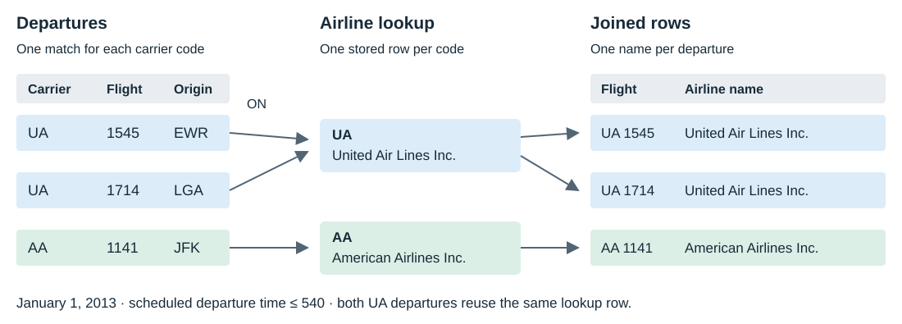

# Joining two tables {#sec-joins}

```{r join-setup, include=FALSE}
source("scripts/sql-setup.R")
```

## Introduction

In this chapter, we will learn to:

- identify the keys connecting two tables
- look up airline names with `JOIN ... ON`
- use table aliases and qualified column names
- retain departures without aircraft records using `LEFT JOIN`
- find and count rows with no match
- distinguish a missing match from a missing attribute

The flight table contains carrier codes, but we often want airline names
in a report. The aircraft table contains models, but we want those models
beside departures. A join combines related rows from two tables so we
can ask these questions in one query.

We will work with two tables at a time. First we join `flights` to
`airlines`; then we join `flights` to `planes`. In both examples, several
departures can look up the same row in the other table.

## Set Up

Open `data/flights.sqlite` to follow along with the SQL examples. The
shared setup from @sec-sql-intro supplies all three tables. No R syntax
is needed to read the queries.

| Table | One row describes | Column connecting it to the example |
|:--|:--|:--|
| `flights` | One scheduled departure | `carrier` or `tailnum` |
| `airlines` | One airline | `carrier` |
| `planes` | One aircraft record | `tailnum` |

Let us inspect a few airline names and aircraft records:

```{sql, connection=con}
SELECT carrier, name
FROM airlines
ORDER BY carrier
LIMIT 5;
```

```{sql, connection=con}
SELECT tailnum, year, manufacturer, model
FROM planes
ORDER BY tailnum
LIMIT 5;
```

`year` in `planes` describes the aircraft's year of manufacture. `year`
in `flights` describes the departure year. The names happen to be the
same, but their meanings differ. We will use tail numbers to connect
these tables.

### Keys and why tables are split

A key identifies a row. Each `airlines.carrier` value occurs once in that
table, and each `planes.tailnum` value occurs once in `planes`. Those
columns are the lookup keys in our examples.

The corresponding columns in `flights` can repeat. An airline operates
many departures, and an aircraft can appear on many flight rows. These
repetitions describe the relationship between departures and the lookup
tables; they are expected.

Keeping airline details in a separate table gives us one place to record
each airline name. The departure rows carry its code. When we need a
name, we match that code to the airline table. We do not need to store
the full name again on every departure.

A matching column must represent the same thing in both tables. Having
the same name or containing numbers is not enough. A flight number
identifies a service, not an aircraft; it cannot replace a tail number
as the aircraft lookup key.

We can check the aircraft key before using it:

```{sql, connection=con}
SELECT COUNT(*) AS aircraft_records,
       COUNT(tailnum) AS recorded_keys,
       COUNT(DISTINCT tailnum) AS different_keys
FROM planes;
```

The three counts agree. Every aircraft row has a tail number, and every
recorded tail number is different. This check supports our expectation
that looking up one tail number supplies at most one aircraft record.
It also supports using the aircraft-side tail number to detect missing
matches later. We should establish what a lookup key means before
trusting a report built from it.

## INNER JOIN

`INNER JOIN` returns rows that satisfy the matching condition. Let us
attach airline names to the first few scheduled departures:

```{sql, connection=con}
SELECT flights.flight_date, flights.flight, flights.carrier,
       airlines.name, flights.origin, flights.dest
FROM flights
INNER JOIN airlines ON flights.carrier = airlines.carrier
ORDER BY flights.flight_date, flights.sched_dep_time,
         flights.carrier, flights.flight, flights.origin
LIMIT 6;
```

`FROM flights` supplies the departure rows. `INNER JOIN airlines` supplies
the names. `ON flights.carrier = airlines.carrier` specifies which rows
belong together. We write the condition explicitly so the relationship
can be read and checked.

The join adds information to a result row; it does not change either
stored table. Selecting fewer columns makes the result easier to inspect.
We can display the departure's carrier code and the airline name without
also displaying the duplicate code from `airlines`.

### Follow the match row by row

Take the UA departure numbered 1545 on January 1. Its carrier code is
UA, so the condition matches the UA row in `airlines`. The result can
then contain both the departure details and United's full name.

The next UA departure looks up the same airline row. Matching it once
does not use up the row. The AA departure looks up the AA row instead.
This picture follows those three departures:



We can run the small example shown in the picture:

```{sql, connection=con}
SELECT f.carrier, f.flight, a.name
FROM flights AS f
INNER JOIN airlines AS a ON f.carrier = a.carrier
WHERE f.flight_date = '2013-01-01' AND f.sched_dep_time <= 540
ORDER BY f.sched_dep_time, f.carrier, f.flight, f.origin;
```

There are three result rows, even though only two airline names are
involved. An inner join does not return a list of unique airlines. It
returns matching combinations of departure and airline rows.

Here every departure finds exactly one airline row. Let us check the
number of matched departures across the whole dataset:

```{sql, connection=con}
SELECT COUNT(*) AS matched_departures
FROM flights AS f
INNER JOIN airlines AS a ON f.carrier = a.carrier;
```

The count equals the flight table's row count. That result depends on
two facts: every carrier has a match, and the airline lookup key is
unique. An inner join to a different table can lose departures with no
match. We will see that with aircraft records.

This makes `airlines` a useful first lookup: we can focus on the matching
syntax without losing departure rows. It does not make inner and left
joins interchangeable in general. Their results agree for this lookup
because the recorded carrier values are all covered. The aircraft
lookup has different coverage, so its results make the choice visible.

### Aliases and qualified columns

`AS f` gives `flights` the temporary name `f` inside this query. `AS a`
does the same for `airlines`. A qualified column name, such as
`f.carrier`, says which table supplies the column.

Both tables have a column named `carrier`. An unqualified reference to
`carrier` is ambiguous in this join. SQLite cannot choose its source
from that name alone. Use the aliases in `SELECT`, `ON`, filters,
grouping and sorting so the source stays clear.

Table aliases and result aliases have different jobs. In `COUNT(*) AS
departures`, `departures` names an output column. In `flights AS f`, `f`
names an input table for the current query. Neither changes a stored name.

Use short aliases that remain easy to recognize: `f` for flights, `a`
for airlines and `p` for planes. Once a table has an alias, use that
alias consistently throughout the query.

### Summarize after a join

We can group the joined rows as we grouped a single table. Let us count
departures for each airline and show the five largest counts:

```{sql, connection=con}
SELECT f.carrier, a.name, COUNT(*) AS departures
FROM flights AS f
INNER JOIN airlines AS a ON f.carrier = a.carrier
GROUP BY f.carrier, a.name
ORDER BY departures DESC, f.carrier
LIMIT 5;
```

One row now represents one carrier and its name. `COUNT(*)` counts the
joined departure rows. Because each departure matches exactly one
airline, those are also departure counts. We retain the carrier code
alongside the name so the identifier remains visible in the report.

## LEFT JOIN

An inner join to `planes` retains only departures with a matching aircraft
record. Let us count them:

```{sql, connection=con}
SELECT COUNT(*) AS matched_departures
FROM flights AS f
INNER JOIN planes AS p ON f.tailnum = p.tailnum;
```

This count is smaller than the number of scheduled departures. Some
tail numbers are missing in `flights`. Others are recorded there but
absent from `planes`. An aircraft lookup should not silently remove
those departure rows when the question is about all departures.

A missing flight tail number cannot satisfy `f.tailnum = p.tailnum`.
SQL equality does not treat `NULL` as a known identifier equal to another
value. A recorded identifier absent from the aircraft table also has
no matching row, for a different reason. The left join handles both by
retaining the departure and leaving the aircraft-side columns missing.

`LEFT JOIN` keeps every row of the table written on its left. When a
right-hand row matches, its columns are available as usual. When no
right-hand row matches, its columns contain SQL `NULL` in the result.

Let us keep the flights and add whatever aircraft details are available:

```{sql, connection=con}
SELECT f.flight_date, f.carrier, f.flight, f.origin,
       f.tailnum, p.tailnum AS matched_tailnum, p.model
FROM flights AS f
LEFT JOIN planes AS p ON f.tailnum = p.tailnum
ORDER BY f.flight_date, f.sched_dep_time, f.carrier, f.flight, f.origin
LIMIT 6;
```

The two tail-number columns help us inspect the match. The original
`f.tailnum` stays with the departure. `p.tailnum` comes from the aircraft
row and becomes `NULL` when there is no match. The output may display
that missing value as `NA`.

### Count matches and gaps

Since `planes.tailnum` is unique and nonmissing, each departure can
match at most one aircraft row. The left join therefore retains exactly
one result row per departure. We can count all rows and matching keys
in the same query:

```{sql, connection=con}
SELECT COUNT(*) AS departures,
       COUNT(p.tailnum) AS matched_departures,
       COUNT(*) - COUNT(p.tailnum) AS unmatched_departures
FROM flights AS f
LEFT JOIN planes AS p ON f.tailnum = p.tailnum;
```

All departure rows contribute to `COUNT(*)`. Only rows with a matching
aircraft key contribute to `COUNT(p.tailnum)`. The difference counts
departures without an aircraft match. These are departure counts, not
counts of different aircraft.

In this database, the matched and unmatched counts add back to the
original flight count. Keep that check in mind when adding a lookup
column to a report. The desired row meaning is still one scheduled
departure.

## Find rows with no match

To inspect the gaps, keep the left join and filter for a missing key
from the right table:

```{sql, connection=con}
SELECT f.flight_date, f.carrier, f.flight, f.origin,
       f.tailnum, p.tailnum AS matched_tailnum, p.model
FROM flights AS f
LEFT JOIN planes AS p ON f.tailnum = p.tailnum
WHERE p.tailnum IS NULL
ORDER BY f.flight_date, f.sched_dep_time, f.carrier, f.flight, f.origin
LIMIT 6;
```

For example, the AA 301 departure from LGA on January 1 records tail
number N3ALAA. There is no N3ALAA row in `planes`. The left join retains
the flight's tail number, while its aircraft-side key and model are
`NULL`. The missing match tells us about this lookup, not whether the
aircraft existed or the departure took place.

Testing `f.tailnum IS NULL` would find only flights whose own tail number
is missing. It would miss N3ALAA and other recorded identifiers absent
from `planes`. Testing `p.tailnum IS NULL` covers both causes of no match.

Let us separate those causes with two counts. First, count missing
tail numbers in the original flight table:

```{sql, connection=con}
SELECT COUNT(*) AS missing_flight_tailnums
FROM flights
WHERE tailnum IS NULL;
```

Then count departures with a recorded tail number but no aircraft record:

```{sql, connection=con}
SELECT COUNT(*) AS departures_with_unlisted_tailnum,
       COUNT(DISTINCT f.tailnum) AS unlisted_tailnums
FROM flights AS f
LEFT JOIN planes AS p ON f.tailnum = p.tailnum
WHERE p.tailnum IS NULL AND f.tailnum IS NOT NULL;
```

The second query distinguishes departure rows from different identifiers.
A tail number absent from `planes` can appear on many departures.
Adding the two departure counts gives the unmatched-departure count
from the earlier left join.

The absent lookup record does not tell us why the record is missing.
It might require checking the source data or the identifier's coverage.
For this report we can state the observable result precisely: the
departure has no matching aircraft row in this database. That statement
stays valid for both a missing identifier and an unlisted one.

### A missing attribute is not a missing match

An aircraft record can exist while one of its attributes is missing.
Let us find examples whose year of manufacture is unknown:

```{sql, connection=con}
SELECT f.flight_date, f.carrier, f.flight, f.tailnum,
       p.tailnum AS matched_tailnum, p.year AS plane_year, p.model
FROM flights AS f
INNER JOIN planes AS p ON f.tailnum = p.tailnum
WHERE p.year IS NULL
ORDER BY f.flight_date, f.sched_dep_time, f.carrier, f.flight, f.origin
LIMIT 5;
```

These rows have matched tail numbers, so the aircraft lookup succeeded.
Only the manufacture year is missing. In a left join, `WHERE p.year IS
NULL` would include both such matches and departures without aircraft
records. To identify a missing match, test the nonmissing lookup key.

## Place conditions carefully

Read a left join as matching rows, retaining unmatched left rows, then
applying `WHERE`. A condition on the right table can therefore remove
the unmatched rows that the join just retained.

Suppose we want only departures matched to aircraft manufactured from
2000 onward:

```{sql, connection=con}
SELECT COUNT(*) AS qualifying_departures
FROM flights AS f
LEFT JOIN planes AS p ON f.tailnum = p.tailnum
WHERE p.year >= 2000;
```

Unmatched rows have `NULL` for `p.year`, which does not satisfy this
condition. Matched aircraft with a missing year also fail the filter.
The result covers only departures with a qualifying recorded year.

For a different question, we might want every departure, attaching
aircraft details only when the recorded year is at least 2000. Put that
restriction inside the matching condition:

```{sql, connection=con}
SELECT COUNT(*) AS departures,
       COUNT(p.tailnum) AS qualifying_aircraft_matches
FROM flights AS f
LEFT JOIN planes AS p
  ON f.tailnum = p.tailnum AND p.year >= 2000;
```

All left rows survive. Aircraft-side columns are missing when no row
satisfies both matching conditions, even if the tail number alone exists
in `planes`. “No match” always refers to the complete `ON` condition.
Choose its conditions from the question rather than moving a filter
simply to make a row count larger.

Table order matters too. `FROM planes LEFT JOIN flights` would preserve
aircraft records. Our question asks us to preserve departures, so we
write `FROM flights LEFT JOIN planes`.

A left join also does not add aircraft rows that no selected departure
uses. Its promise concerns the left rows only. The right table supplies
matching details, rather than a second list of rows appended to the
result. If we reverse the tables, we have changed the question and the
row meaning, even though the equality condition looks the same.

The position of a table in the query is separate from the displayed
column order. We can select `p.model` before `f.flight` and still preserve
flights, because `FROM flights LEFT JOIN planes` determines that choice.
`SELECT` controls which columns we see and in what order.

## Why Venn diagrams can mislead

A Venn diagram shows overlapping sets. It can suggest which side a join
keeps, but it does not explain how column values form result rows.
Flights and airline records describe different things; they are not two
sets of interchangeable rows.

In the earlier picture, two UA departures both receive the same airline
name. A single overlapping circle does not show that repeated lookup.
It also does not show the `NULL` columns created for an unmatched left
row. Follow the input rows and the `ON` condition to understand those
details.

A shared column name is not an instruction to match it automatically.
Our aircraft join uses `tailnum`, even though both tables also have a
`year` column. The matching relationship comes from what the columns mean.

Whenever we want a departure plus a lookup value, trace one departure
to its matching key. Then ask what should happen when that key has no
match. Those two questions tell us more than the overlap of two circles.

## SQLite RIGHT / FULL support {#the-sqlite-right-full-trap}

SQLite supports `RIGHT JOIN` and `FULL OUTER JOIN` starting with
version 3.39.0, as recorded in its
[release notes](https://www.sqlite.org/releaselog/3_39_0.html).
Check the version used by your own connection:

```{sql, connection=con}
SELECT sqlite_version() AS sqlite_version;
```

`RIGHT JOIN` preserves the right-hand table; `FULL OUTER JOIN` preserves
unmatched rows from both sides. Both run in the RSQLite build used for
this book. Older SQLite builds may reject them. We use `LEFT JOIN`
throughout these examples; swapping the two table positions expresses
the corresponding right-preserving lookup with the same condition.

## JOINs with dbplyr

For the R equivalents, see [JOINs with dbplyr](dbplyr.qmd#joins-with-dbplyr)
in Part II.

## semi_join and anti_join

For filtering joins with R verbs, see
[semi_join and anti_join](dbplyr.qmd#semi_join-and-anti_join) in Part II.

## Common mistakes

> **Check the relationship and the rows we want to keep**
>
> - **Any two identifier columns can be matched.** Match carrier codes
>   to carrier codes and aircraft tail numbers to tail numbers.
> - **A shared column name needs no table prefix.** Use `f.carrier`
>   and `a.carrier` to remove ambiguity.
> - **Omitting `ON` must produce an error.** SQLite can accept the join
>   and combine unrelated rows. Write the matching condition explicitly.
> - **An inner join keeps departures without an aircraft record.**
>   Use a left join when those departures must remain.
> - **A left join keeps all rows from both tables.** It preserves the
>   left table. Choose that table from the question.
> - **Any missing aircraft attribute proves no match.** Test `p.tailnum`,
>   whose value is present in every stored aircraft record.
> - **A right-table filter in `WHERE` preserves unmatched rows.** A
>   condition such as `p.year >= 2000` removes them.

<span id="exercises"></span>

## Try it

Attempt each question before opening its answer. Keep the matching key
visible when checking individual rows.

1. Show six departures with airline names, ordered by date, scheduled
   time, carrier, flight number and origin.

<details>
<summary>Answer</summary>

```{sql, connection=con}
SELECT f.flight_date, f.sched_dep_time, f.carrier, f.flight,
       f.origin, f.dest, a.name
FROM flights AS f
INNER JOIN airlines AS a ON f.carrier = a.carrier
ORDER BY f.flight_date, f.sched_dep_time, f.carrier, f.flight, f.origin
LIMIT 6;
```

</details>

2. Count July departures by airline code and name. Show the busiest first.

<details>
<summary>Answer</summary>

```{sql, connection=con}
SELECT f.carrier, a.name, COUNT(*) AS departures
FROM flights AS f
INNER JOIN airlines AS a ON f.carrier = a.carrier
WHERE f.month = 7
GROUP BY f.carrier, a.name
ORDER BY departures DESC, f.carrier;
```

Each departure matches one airline, so the joined row count is a
departure count.

</details>

3. Show six departures without an aircraft match. Why test the key from
   `planes` rather than the tail number from `flights`?

<details>
<summary>Answer</summary>

```{sql, connection=con}
SELECT f.flight_date, f.carrier, f.flight, f.origin, f.tailnum
FROM flights AS f
LEFT JOIN planes AS p ON f.tailnum = p.tailnum
WHERE p.tailnum IS NULL
ORDER BY f.flight_date, f.sched_dep_time, f.carrier, f.flight, f.origin
LIMIT 6;
```

The right key is missing for every unmatched departure. The flight's
tail number can be recorded even when the lookup fails.

</details>

4. For each origin, count all departures, matched aircraft records and
   departures without a match.

<details>
<summary>Answer</summary>

```{sql, connection=con}
SELECT f.origin, COUNT(*) AS departures,
       COUNT(p.tailnum) AS matched_departures,
       COUNT(*) - COUNT(p.tailnum) AS unmatched_departures
FROM flights AS f
LEFT JOIN planes AS p ON f.tailnum = p.tailnum
GROUP BY f.origin
ORDER BY f.origin;
```

The two match-status counts add to the departure count for each origin.

</details>

5. Count departures that have an aircraft match but no recorded
   manufacture year. Should these be called unmatched departures?

<details>
<summary>Answer</summary>

```{sql, connection=con}
SELECT COUNT(*) AS matched_departures_without_year
FROM flights AS f
INNER JOIN planes AS p ON f.tailnum = p.tailnum
WHERE p.year IS NULL;
```

They are matched departures with a missing attribute. The inner join
has already required the tail number to match.

</details>

6. Keep every departure from JFK on January 1 and attach aircraft
   details only for aircraft manufactured from 2000 onward. Preview six rows.

<details>
<summary>Answer</summary>

```{sql, connection=con}
SELECT f.flight_date, f.carrier, f.flight, f.tailnum,
       p.tailnum AS qualifying_tailnum, p.year AS plane_year, p.model
FROM flights AS f
LEFT JOIN planes AS p
  ON f.tailnum = p.tailnum AND p.year >= 2000
WHERE f.origin = 'JFK' AND f.flight_date = '2013-01-01'
ORDER BY f.sched_dep_time, f.carrier, f.flight
LIMIT 6;
```

The left-table conditions select the departures in `WHERE`. The aircraft
year condition belongs in `ON` so departures without a qualifying
aircraft match survive. `LIMIT` previews six of those departures.

</details>

## Key points

- Join keys must describe the same identifier in both tables.
- `JOIN ... ON` matches rows; aliases keep each column's source clear.
- `LEFT JOIN` preserves the left table and supplies `NULL` for missing matches.
- Test a nonmissing right-hand key to find rows without a match.
- Apply right-table filters carefully: `WHERE` can remove retained rows.

Next: Where SQL goes next (planned chapter 7).
For the next available material, continue to [SQL from R with DBI](dbi.qmd).

Practise in [Intro to SQL, lessons 9–10]().

```{r join-close, include=FALSE}
DBI::dbDisconnect(con)
```
