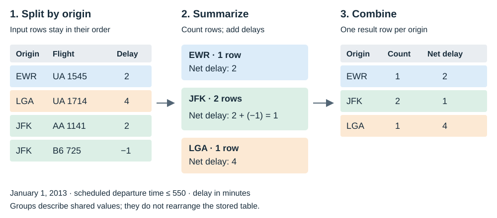

# Summaries and groups {#sec-sql2}

```{r sql-advanced-setup, include=FALSE}
source("scripts/sql-setup.R")
```

## Introduction

In this chapter, we will learn to:

- count rows and recorded values with `COUNT`
- calculate totals, averages and extremes
- list and count distinct values
- summarize rows in groups with `GROUP BY`
- filter rows with `WHERE` and groups with `HAVING`
- read a summary query in its logical order

Earlier queries returned individual flights. A summary answers a different
question: how many flights were scheduled, or what was their average delay?
We combine several input rows into one result row.

We use the New York City departures in `flights`. Each row represents one
scheduled departure in 2013. A flight number can occur on many dates, so
counting flight numbers does not count different services or aircraft.
Before writing a summary, say what we want to count.

## Set Up

Open `data/flights.sqlite` in your SQL tool to follow along. The examples
use the shared database described in @sec-sql-intro. Results below each
query are computed from that database when the book renders.

We will use `origin`, `carrier`, `dest`, `distance` and `dep_delay`.
Distance is in miles and departure delay is in minutes. A negative delay
means an early departure. A missing delay is stored as SQL `NULL` and
may appear as `NA` in the displayed results.

Keep the unit beside the question. “Average delay” and “total delay” use
the same input column but describe different things. Also name the
population: all scheduled departures, departures from JFK, or departures
with a recorded delay. These choices determine the rows and denominator.

## Aggregate

An aggregate function combines values from several rows. Without a
`GROUP BY` clause, an aggregate query summarizes all qualifying rows as
one group. Let us count the scheduled departures:

```{sql, connection=con}
SELECT COUNT(*) AS departures
FROM flights;
```

`COUNT(*)` counts rows, including rows with missing values in some columns.
The result contains one row with the total. The asterisk here means
“count every row”; it does not return every column as `SELECT *` does.

### Count rows and recorded delays

`COUNT(column)` counts rows where that column is not `NULL`. Let us compare
the number of scheduled departures with the number of recorded delays:

```{sql, connection=con}
SELECT COUNT(*) AS departures,
       COUNT(dep_delay) AS recorded_delays,
       COUNT(*) - COUNT(dep_delay) AS missing_delays
FROM flights;
```

The difference counts rows with a missing departure delay. A zero delay
is a recorded value and contributes to `COUNT(dep_delay)`. A negative
delay contributes too. Missing and zero therefore need different treatment.

Neither count tells us how many aircraft flew. Many departure rows share
a tail number. Whenever we want the number of rows, use `COUNT(*)`;
whenever we want the number of recorded values, name the column.

### Total, average, minimum and maximum

`SUM` adds the recorded values. `AVG` calculates their arithmetic mean.
`MIN` returns the smallest value and `MAX` the largest. Let us apply all
four to departure delay:

```{sql, connection=con}
SELECT SUM(dep_delay) AS net_delay_minutes,
       ROUND(AVG(dep_delay), 2) AS avg_delay_minutes,
       MIN(dep_delay) AS earliest_minutes,
       MAX(dep_delay) AS latest_minutes
FROM flights;
```

The minimum is negative because some flights left early. The sum includes
those negative values, which offset positive delays. It is a *net* delay,
not a total of minutes spent waiting after the scheduled departure time.

If the question asks for the total positive departure delay, keep only
positive delays before adding them:

```{sql, connection=con}
SELECT COUNT(*) AS delayed_departures,
       SUM(dep_delay) AS positive_delay_minutes,
       ROUND(AVG(dep_delay), 2) AS avg_positive_delay
FROM flights
WHERE dep_delay > 0;
```

This average describes only flights that left late. It answers a different
question from the previous average, which also included on-time and early
departures. A filter changes the population behind every aggregate in
the query.

`MAX(dep_delay)` returns a delay value. It does not identify the flight
that had it. To inspect individual flights with the largest delays, use
the earlier pattern, `ORDER BY dep_delay DESC LIMIT 5`, and select their
identifying columns.

### Missing values in summaries

`SUM`, `AVG`, `MIN` and `MAX` skip `NULL` inputs. For an average, SQLite
divides by the number of recorded values, not by all rows. We can make
that denominator visible:

```{sql, connection=con}
SELECT COUNT(*) AS departures,
       COUNT(dep_delay) AS recorded_delays,
       SUM(dep_delay) * 1.0 / COUNT(dep_delay) AS calculated_average,
       AVG(dep_delay) AS average_delay
FROM flights
WHERE origin = 'JFK';
```

The two averages agree. Multiplying by `1.0` lets the division retain a
fraction when the sum and count are whole numbers. Usually `AVG` is the
clearer way to ask for an average.

What if the input contains no recorded values? Let us restrict the query
to departures whose delay is missing:

```{sql, connection=con}
SELECT COUNT(*) AS departures,
       COUNT(dep_delay) AS recorded_delays,
       SUM(dep_delay) AS total_delay,
       AVG(dep_delay) AS average_delay,
       MIN(dep_delay) AS minimum_delay,
       MAX(dep_delay) AS maximum_delay
FROM flights
WHERE dep_delay IS NULL;
```

There are rows to count, but no recorded delays to summarize. The four
numeric aggregates return `NULL`, while `COUNT(dep_delay)` returns zero.
Replacing those unknown delays with zero would change the meaning of
the data. The planned chapter on `NULL` develops that distinction further.

An empty input is another useful check. The database has no departures
with origin code `'XXX'`. An aggregate query without grouping still
returns one summary row:

```{sql, connection=con}
SELECT COUNT(*) AS departures, COUNT(dep_delay) AS recorded_delays,
       SUM(dep_delay) AS total_delay, AVG(dep_delay) AS average_delay
FROM flights
WHERE origin = 'XXX';
```

Both counts are zero. The total and average are `NULL` because there are
no recorded values. Compare this with the previous example: its delay
count was also zero, but its departure count was positive. Showing both
counts distinguishes “no departures selected” from “departures selected,
but all delays missing.” With `GROUP BY origin`, an empty input has no
origin groups and therefore produces no result rows.

### Choose a measure that answers the question

Let us summarize distance for departures from JFK:

```{sql, connection=con}
SELECT COUNT(*) AS departures,
       SUM(distance) AS departure_distance_miles,
       ROUND(AVG(distance), 2) AS avg_distance_miles,
       MIN(distance) AS shortest_distance_miles,
       MAX(distance) AS longest_distance_miles
FROM flights
WHERE origin = 'JFK';
```

The sum adds the distance on every departure row. A route flown many
times contributes many times, which suits a departure-distance total.
The average describes the distance of a departure chosen from these
rows. It is not the average of the different routes served from JFK.
The table's row meaning determines the weight each observation receives.

Read each result heading with its unit. Counts are departures, while
the other columns contain miles. A larger total distance can reflect
more departures, longer trips, or both. Keep the count beside the total
when comparing airports.

### Distinct values

`DISTINCT` removes repeated combinations from the selected columns.
Let us list the departure airports:

```{sql, connection=con}
SELECT DISTINCT origin
FROM flights
ORDER BY origin;
```

There is one result row per different origin, regardless of how many
departures used it. Adding another selected column changes what counts
as a repeated combination:

```{sql, connection=con}
SELECT DISTINCT origin, carrier
FROM flights
WHERE carrier IN ('AA', 'UA')
ORDER BY origin, carrier;
```

Here a result row represents an origin/carrier pair. An origin can appear
several times because each carrier makes a different pair. `DISTINCT`
applies to the whole selected row, not just the first column.

`COUNT(DISTINCT column)` counts different nonmissing values without
listing them. Compare the counts for the flight table:

```{sql, connection=con}
SELECT COUNT(*) AS departures,
       COUNT(carrier) AS recorded_carriers,
       COUNT(DISTINCT carrier) AS different_carriers,
       COUNT(DISTINCT tailnum) AS different_tailnums
FROM flights;
```

A recorded carrier is counted again on every departure. A distinct
carrier is counted once across the selected rows. Distinct tail numbers
count different recorded aircraft identifiers; missing tail numbers do
not contribute. This is why `COUNT(carrier)` is not a count of airlines.

The placement of `DISTINCT` matters. `SELECT DISTINCT carrier` removes
repeated carrier values from a list. `COUNT(DISTINCT carrier)` removes
repeated carrier inputs before counting them. Writing `SELECT DISTINCT
COUNT(carrier)` would first count the recorded carrier values, then
remove repeated output rows. Since that aggregate already returns one
row, the outer `DISTINCT` would not turn the count into an airline count.

Use the question to choose between a list and a number. “Which airlines
appear?” calls for a distinct list. “How many airlines appear?” calls
for a distinct count. Neither query changes the stored flight rows.

## Alias

An alias gives a result column a temporary name. Write `AS` after the
expression, followed by the name we want in the output:

```{sql, connection=con}
SELECT COUNT(*) AS jfk_departures,
       ROUND(AVG(dep_delay), 2) AS avg_delay_minutes
FROM flights
WHERE origin = 'JFK';
```

The names explain both the population and the unit. Use short names
with underscores so we can refer to them without quoting spaces.
An alias changes the result heading; it does not rename a stored column.

Rounding helps us read the displayed average. We keep the underlying
`AVG(dep_delay)` expression when applying a precise threshold later.
Otherwise a value close to the threshold could be classified by its
rounded display rather than by the average itself.

## Group By

`GROUP BY` divides the qualifying rows into groups with shared values.
The aggregates then summarize each group separately. Let us count
departures and average their delays for each origin:

```{sql, connection=con}
SELECT origin, COUNT(*) AS departures,
       COUNT(dep_delay) AS recorded_delays,
       ROUND(AVG(dep_delay), 2) AS avg_delay_minutes
FROM flights
GROUP BY origin
ORDER BY origin;
```

Each result row now represents one airport. All EWR departures contribute
to the EWR summary, all JFK departures to JFK, and all LGA departures to
LGA. Missing delays still count as departures but do not enter the average.

The recorded-delay counts also tell us how much information supports
each average. Two origins can have similar averages but different numbers
of measured departures. If the question is about missing records, compare
the count difference instead of interpreting a missing value as a delay.

Avoid averaging these three airport averages to obtain the overall
departure average. Each airport has a different number of recorded delays.
Use `AVG(dep_delay)` on the original departure rows for the overall
answer. That gives each recorded departure delay the same weight.

### Split, summarize, combine

We can understand grouping in three steps. Split the input by the group
column, summarize within each group, then combine those summaries into
one result table. This is a way to read the query, not a description of
how SQLite must physically store or move rows.

{fig-alt="Four early January 1 departures split into three origin groups, giving counts of one for EWR, two for JFK and one for LGA."}

The picture uses four actual departures. We can inspect the input rows
before summarizing them:

```{sql, connection=con}
SELECT origin, carrier, flight, dep_delay
FROM flights
WHERE flight_date = '2013-01-01' AND sched_dep_time <= 550
ORDER BY sched_dep_time, carrier, flight, origin;
```

Apply the same filter and group by origin:

```{sql, connection=con}
SELECT origin, COUNT(*) AS departures,
       SUM(dep_delay) AS net_delay_minutes
FROM flights
WHERE flight_date = '2013-01-01' AND sched_dep_time <= 550
GROUP BY origin
ORDER BY origin;
```

JFK has two input rows. Their delays, 2 and -1 minutes, add to 1 minute.
The grouped result has three rows because there are three origins.
Counting input rows and counting result rows answer different questions.

### Choose the group columns

For one summary per origin and carrier, include both columns in
`GROUP BY`. Let us compare AA and UA within each origin:

```{sql, connection=con}
SELECT origin, carrier, COUNT(*) AS departures,
       ROUND(AVG(dep_delay), 2) AS avg_delay_minutes
FROM flights
WHERE carrier IN ('AA', 'UA')
GROUP BY origin, carrier
ORDER BY origin, carrier;
```

One row means one observed origin/carrier combination. Adding a group
column makes the summary more detailed. Removing `carrier` combines
the selected airlines into one summary per origin.

Grouping returns combinations present in the filtered input. It does not
invent an origin/carrier combination with a count of zero when that
combination has no departures. This matters when reading a short result:
an absent row is not a displayed zero. First inspect the filter, then
check which combinations are actually recorded.

Keep each selected column either in `GROUP BY` or inside an aggregate.
For example, selecting `dest` while grouping only by `carrier` leaves no
single destination to report for a carrier serving several destinations.

SQLite allows some queries with such ungrouped columns. It may take the
value from an input row, producing a plausible label beside a broader
total. Successful execution does not make that label meaningful. Decide
what one result row represents, then make every selected value fit it.

## Order By

`GROUP BY` defines the groups. `ORDER BY` defines their display order.
Let us put the busiest carriers first:

```{sql, connection=con}
SELECT carrier, COUNT(*) AS departures
FROM flights
GROUP BY carrier
ORDER BY departures DESC, carrier
LIMIT 5;
```

We use the alias `departures` to sort the summary. `DESC` puts the largest
counts first, and `carrier` breaks ties. Without `ORDER BY`, the query
does not promise any particular order, even if a result looks sorted.

`LIMIT 5` caps the displayed summary rows. It does not limit the input
to five departures before counting them. Each count above uses all
qualifying flight rows for that carrier.

## Filter groups with HAVING

`WHERE` filters individual rows before grouping. `HAVING` filters the
groups after their aggregates have been calculated. Let us count July
departures by carrier and retain carriers with at least 1,000 departures:

```{sql, connection=con}
SELECT carrier, COUNT(*) AS departures,
       ROUND(AVG(dep_delay), 2) AS avg_delay_minutes
FROM flights
WHERE month = 7
GROUP BY carrier
HAVING COUNT(*) >= 1000
ORDER BY departures DESC, carrier;
```

The month filter chooses the input rows. The count threshold chooses
which carrier summaries remain. Every displayed count is a July count,
because other months were removed before grouping.

The threshold hides smaller carrier groups from this report. Their
departures still existed in the July input, but their summary rows do
not pass `HAVING`. If we need a complete July total, remove the group
threshold before interpreting the report as coverage of all departures.
Use an inclusive comparison, `>=`, when the question says “at least”;
`> 1000` would exclude a group containing exactly 1,000 rows.

We cannot place `COUNT(*) >= 1000` in `WHERE`. An individual flight row
has no group count yet. Write the aggregate condition in `HAVING`, after
`GROUP BY` in the query.

Consider “carriers whose average July delay exceeded 20 minutes.” The
condition is `HAVING AVG(dep_delay) > 20`. Using `WHERE dep_delay > 20`
would first discard shorter delays and early departures. We would then
calculate a different average, over only the retained flights.

Whenever we want to keep certain input rows, use `WHERE`. Whenever we
want to keep groups based on a summary, use `HAVING`.

## Written order and logical order

SQL begins with `SELECT` when we write it. To understand a summary, start
with the source rows and follow the transformations:

| Written position | Clause | Logical role |
|:--|:--|:--|
| 1 | `SELECT` | Choose group columns and calculate summary expressions |
| 2 | `FROM` | Read the input table |
| 3 | `WHERE` | Keep qualifying input rows |
| 4 | `GROUP BY` | Form groups and calculate their aggregates |
| 5 | `HAVING` | Keep qualifying groups |
| 6 | `ORDER BY` | Sort the result rows |
| 7 | `LIMIT` | Cap the displayed result |

Read this as `FROM` → `WHERE` → `GROUP BY` and aggregates → `HAVING` →
`SELECT` → `ORDER BY` → `LIMIT`. The selected aggregates are the same
group summaries that `HAVING` can test. SQLite can choose its own physical
plan; this sequence helps us reason about the answer.

For `SELECT DISTINCT`, repeated selected rows are removed before the
final ordering and limit. In a grouped count, the grouping already
defines one row per selected group combination.

Before sharing a result, check its meaning in words. “One row per carrier
among July departures, with at least 1,000 departures” describes the
previous query completely. Keep that description beside the SQL so the
filter, group and threshold remain clear when we revisit it.

If a summary looks wrong, build it in stages. Inspect a few rows after
the `WHERE` filter. Add `GROUP BY` and a row count, then add the measure
we want. Finally add `HAVING`, sorting and the result limit. This lets
us see whether a surprising result comes from the selected population,
the group definition, or the threshold.

## Common mistakes

> **Check what each count and average describes**
>
> - **`COUNT(carrier)` counts airlines.** It counts recorded carrier
>   values on departure rows. Use `COUNT(DISTINCT carrier)` for airlines.
> - **`SUM(carrier)` counts carrier codes.** Text codes are labels;
>   use a count to count them and numeric columns for totals.
> - **`COUNT(*)` and `COUNT(dep_delay)` are interchangeable.** Missing
>   delays contribute only to the first count.
> - **An aggregate automatically gives one row per origin.** Add
>   `GROUP BY origin`; otherwise the input is summarized as one group.
> - **SQLite rejects every ungrouped selected column.** It can accept
>   one and display a misleading label. Check the meaning of each column.
> - **`GROUP BY` guarantees sorted results.** Add `ORDER BY` explicitly.
> - **`WHERE` can test `AVG(dep_delay)` or `COUNT(*)`.** Put group
>   thresholds in `HAVING`, after `GROUP BY`.

<span id="exercises"></span>

## Try it

Attempt each question before opening the answer. Describe what one
result row represents as well as writing the SQL.

1. Find the average departure delay for each origin, largest first.
   Include the number of recorded delays. Which airport tops the list?

<details>
<summary>Answer</summary>

```{sql, connection=con}
SELECT origin, COUNT(dep_delay) AS recorded_delays,
       ROUND(AVG(dep_delay), 2) AS avg_delay_minutes
FROM flights
GROUP BY origin
ORDER BY avg_delay_minutes DESC, origin;
```

Each row describes one origin. EWR has the largest average, calculated
over recorded departure delays.

</details>

2. What is the longest distance among departures from JFK? Does the
   result identify a particular flight?

<details>
<summary>Answer</summary>

```{sql, connection=con}
SELECT MAX(distance) AS longest_distance_miles
FROM flights
WHERE origin = 'JFK';
```

The result is one distance value. It does not identify the departure or
tell us how many flights share that distance.

</details>

3. Among AA departures, show the five busiest destinations. Break ties
   alphabetically by destination code.

<details>
<summary>Answer</summary>

```{sql, connection=con}
SELECT dest, COUNT(*) AS departures
FROM flights
WHERE carrier = 'AA'
GROUP BY dest
ORDER BY departures DESC, dest
LIMIT 5;
```

One row describes an AA destination. `WHERE` selects AA flights before
we count them; `LIMIT` acts on the sorted destination summaries.

</details>

4. Count different destinations served from each origin during July.

<details>
<summary>Answer</summary>

```{sql, connection=con}
SELECT origin, COUNT(DISTINCT dest) AS destinations
FROM flights
WHERE month = 7
GROUP BY origin
ORDER BY origin;
```

Repeated departures to the same destination contribute once per origin.

</details>

5. Find carriers with at least 1,000 July departures and an average
   departure delay above 20 minutes. Where do the two thresholds belong?

<details>
<summary>Answer</summary>

```{sql, connection=con}
SELECT carrier, COUNT(*) AS departures,
       ROUND(AVG(dep_delay), 2) AS avg_delay_minutes
FROM flights
WHERE month = 7
GROUP BY carrier
HAVING COUNT(*) >= 1000 AND AVG(dep_delay) > 20
ORDER BY avg_delay_minutes DESC, carrier;
```

Both thresholds describe groups, so both belong in `HAVING`. The average
uses recorded delays; the departure count includes rows with missing delays.

To check the answer, temporarily remove `HAVING` and inspect all carrier
summaries for July. Then restore the thresholds and confirm that every
remaining carrier meets both. Keeping the month filter unchanged makes
this a comparison of the same population.

</details>

6. Count missing departure delays for each origin without discarding
   rows that have a recorded delay.

<details>
<summary>Answer</summary>

```{sql, connection=con}
SELECT origin, COUNT(*) - COUNT(dep_delay) AS missing_delays
FROM flights
GROUP BY origin
ORDER BY origin;
```

The subtraction counts missing delays while keeping all scheduled
departures in each input group.

</details>

## Key points

- `COUNT(*)` counts rows; `COUNT(column)` counts nonmissing values.
- Numeric aggregates skip `NULL`; an average uses recorded values only.
- `DISTINCT` lists unique combinations; `COUNT(DISTINCT column)` counts values.
- `GROUP BY` defines the summaries; `ORDER BY` defines their display order.
- `WHERE` filters input rows, and `HAVING` filters completed groups.

Next: [NULL and three-valued logic](sql-null.qmd).

Practise in [Intro to SQL, lessons 6–7]().

```{r sql-advanced-close, include=FALSE}
DBI::dbDisconnect(con)
```
