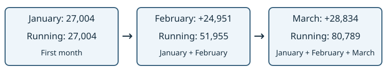
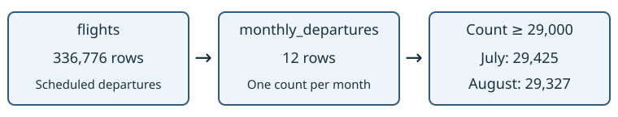

# Where SQL goes next {#sec-sql-next}

```{r sql-next-setup, include=FALSE}
source("scripts/sql-setup.R")
```

## Introduction

In this chapter, we will learn to:

- read a running total calculated with a window function
- follow a query split into a named step with a CTE
- choose a reference for further SQL work or SQL from R

We can now select, calculate, summarize and join data. These operations
answer many questions about flights. Two further tools help when a
question needs a calculation across result rows or a named intermediate
step. Let us preview one example of each.

## Set Up

The examples use `flights` in `data/flights.sqlite`, the same database
as the preceding chapters. Its `month` column contains integers from
1 to 12, and all its flights belong to 2013. Grouping by month therefore
gives one row for each month of that year.

We count scheduled departures, including rows with missing delays.
There is no need to filter on `dep_delay` for this question. Both query
outputs below are computed when the book renders.

## A running total by month

A running total adds the current row's value to the preceding values.
For monthly departures, January starts the total, February adds its
departures to January's, and March adds another month.

A **window function** calculates across related result rows while
keeping those rows available. Let us first count departures by month,
then add those counts in month order:

```{sql, connection=con}
SELECT month, COUNT(*) AS departures,
       SUM(COUNT(*)) OVER (
         ORDER BY month
         ROWS BETWEEN UNBOUNDED PRECEDING AND CURRENT ROW
       ) AS running_departures
FROM flights
GROUP BY month
ORDER BY month;
```

`COUNT(*)` summarizes the flight rows into twelve monthly counts.
`SUM(...) OVER (...)` then works across those monthly result rows.
The two levels of calculation explain the nested `SUM(COUNT(*))`.
An ordinary sum alone would not retain the twelve months beside their
cumulative values.

The `ORDER BY month` inside `OVER` defines the calculation order.
The `ROWS` line defines the window frame: start at the first result
row and continue through the current row. `UNBOUNDED PRECEDING` means
there is no earlier boundary within this result.

{fig-alt="January's 27,004 departures become 51,955 after February and 80,789 after March."}

January contributes 27,004 departures. February contributes 24,951,
so its running total is 51,955. March raises the total to 80,789.
The final row reaches all 336,776 departures in the database.

The final `ORDER BY month` controls display order. Keeping it separate
from the order inside `OVER` makes both purposes explicit. If the data
covered several years, month alone would mix years; we would need to
decide how to separate or order them before calculating the total.

## A named step with a CTE

A **common table expression**, or CTE, gives a query result a name for
the duration of one statement. We introduce it with `WITH`, then use
its name like a table in the main query.

Let us name the monthly counts `monthly_departures`, then keep months
with at least 29,000 scheduled departures:

```{sql, connection=con}
WITH monthly_departures AS (
  SELECT month, COUNT(*) AS departures
  FROM flights
  GROUP BY month
)
SELECT month, departures
FROM monthly_departures
WHERE departures >= 29000
ORDER BY month;
```

Read the parenthesized query first. It produces twelve rows with
columns named `month` and `departures`. The main query reads that result
and filters its count column. July has 29,425 departures and August
has 29,327, so two rows survive.

{fig-alt="A CTE summarizes 336,776 departures into 12 month rows; filtering counts of at least 29,000 keeps July and August."}

Earlier, we used `HAVING` to filter groups within one query. Here,
grouping has already happened inside the named step. The outer `WHERE`
filters ordinary rows from that step, each representing a month.
This example could also be written with `HAVING`; the CTE lets us give
the intermediate result a meaningful name.

The CTE does not create a permanent table. Its name is available only
within this statement. A later query must define it again. Whenever a
query has several conceptual steps, naming an intermediate result can
help us state what each step contains.

## Further reading

The paid SQL track covers subqueries, `CASE`, `UNION`, more complex
joins, window functions and CTEs.

For exact SQLite syntax, use the official
[SQL documentation](https://www.sqlite.org/lang.html), including
[window functions](https://www.sqlite.org/windowfunctions.html) and
[the WITH clause](https://www.sqlite.org/lang_with.html).
The examples here are a preview; those pages describe the full options.

To use these queries from R, continue to [Part II: SQL from R](dbi.qmd).
We start with DBI connections and query results, then work with dbplyr.
The [cheatsheet](cheatsheet.qmd) collects the Part I clauses and NULL
rules alongside the R reference.

## Common mistakes

> - Reading the running total as the count for that month alone.
> - Confusing the window's calculation order with the final display order.
> - Expecting a CTE name to remain available in the next statement.

## Key points

- A window function calculates across result rows while retaining them.
- A running total needs a defined order and frame.
- A CTE names an intermediate result within one statement.
- Part II shows how to send SQL queries from R and use their results.

Next: [SQL from R with DBI](dbi.qmd).

Practise in [Intro to SQL, lesson 12]().

```{r sql-next-close, include=FALSE}
DBI::dbDisconnect(con)
```
